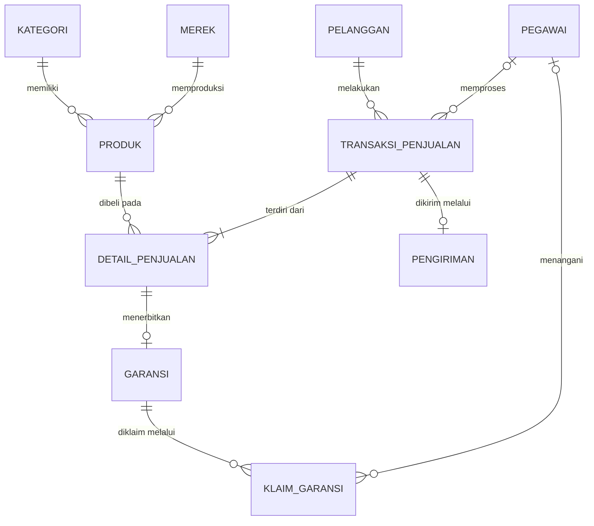

# Sistem Basis Data Toko Gadget Online (Gadgetkuori.com)

**Project Basis Data Kelas A — Kelompok Dahlah terserah**

| No | Nama | NPM |
|---|---|---|
| 1 | Harisa Malfa Liya | 4525210027 |
| 2 | Karel Abimanyu Ahpandi | 4525210031 |
| 3 | Khairul Adam Efendi | 4525210035 |
| 4 | Larasati Dewi | 4525210037 |
| 5 | Muhammad Haikal Azhari | 4525210046 |
| 6 | Adelita Daeli | 4525210049 |

**ERD:** lihat [bagian 12](#12-technical-design) dan berkas [`docs/diagram/ERD_Gadgetkuori.drawio`](docs/diagram/ERD_Gadgetkuori.drawio) (dapat dibuka dan diedit di [draw.io](https://app.diagrams.net)).

## Daftar Isi

1. [Latar Belakang](#1-latar-belakang)
2. [Tujuan](#2-tujuan)
3. [Deskripsi Sistem](#3-deskripsi-sistem)
4. [Kebutuhan Pengguna](#4-kebutuhan-pengguna)
5. [User Story](#5-user-story)
6. [Ruang Lingkup](#6-ruang-lingkup)
7. [Persyaratan Fungsional](#7-persyaratan-fungsional)
8. [Struktur Tabel Database](#8-struktur-tabel-database)
9. [Relasi Antar Tabel](#9-relasi-antar-tabel)
10. [Alur Proses Sistem](#10-alur-proses-sistem)
11. [Persyaratan Non-Fungsional](#11-persyaratan-non-fungsional)
12. [Technical Design](#12-technical-design)
13. [Jadwal dan Timeline](#13-jadwal-dan-timeline)
14. [Risiko dan Asumsi](#14-risiko-dan-asumsi)
15. [Kriteria Keberhasilan](#15-kriteria-keberhasilan)
16. [Persetujuan Pemangku Kepentingan](#16-persetujuan-pemangku-kepentingan)
17. [Kesimpulan](#17-kesimpulan)
18. [Menjalankan Aplikasi](#18-menjalankan-aplikasi)
19. [Lampiran A. Perubahan terhadap PRD Sebelumnya](#lampiran-a-perubahan-terhadap-prd-sebelumnya)

---

## 1. Latar Belakang

Toko gadget tidak luput dari perkembangan teknologi yang memungkinkan kegiatan jual beli dilakukan secara online. Dalam menjalankan toko gadget online, pengelolaan data tidak dapat dilakukan secara sembarangan, melainkan memerlukan sistem basis data yang terstruktur dan rapi agar data produk, pelanggan, stok barang, transaksi, pembayaran, pengiriman, dan garansi dapat dikelola dengan baik serta menghindari kesalahan pencatatan.

Oleh karena itu, sistem basis data ini dibuat untuk memudahkan toko gadget online dalam menyimpan, mengelola, dan mencari data secara efisien. Pembeli dapat melihat katalog, memesan, membayar, memilih mengambil pesanan di toko atau meminta pesanan dikirim ke alamatnya, hingga melacak pengiriman sampai barang diterima. Sistem ini juga membantu pegawai dalam mengelola transaksi, pengiriman, garansi, dan klaim, serta membantu manajer memantau stok dan penjualan melalui laporan untuk mendukung pengambilan keputusan.

## 2. Tujuan

Tujuan dari sistem basis data Toko Gadget Online, yaitu:

- Mengelola data produk, kategori, dan merek beserta stoknya.
- Mengelola data pelanggan dan pegawai.
- Mencatat transaksi penjualan online beserta pembayarannya.
- Mencatat pengiriman pesanan (alamat penerima, kurir, ongkir, nomor resi, dan status) sampai diterima pembeli.
- Mencatat garansi dari produk yang terjual dan klaim garansinya.
- Membantu menghasilkan laporan penjualan dan memantau stok.

## 3. Deskripsi Sistem

Sistem ini merupakan basis data untuk toko online yang menjual produk gadget bermerek dengan layanan garansi dan pengiriman. Sistem diwujudkan sebagai aplikasi web (Gadgetkuori.com) berbasis Laravel dan MySQL. Data dibagi menjadi sepuluh tabel yang saling berhubungan.

Tabel yang digunakan dalam sistem ini meliputi:

- Kategori
- Merek
- Produk
- Pegawai
- Pelanggan
- Transaksi Penjualan
- Detail Penjualan
- Pengiriman
- Garansi
- Klaim Garansi

Tabel Transaksi Penjualan menyimpan informasi transaksi, sedangkan Detail Penjualan menyimpan daftar produk dalam setiap transaksi. Tabel Pengiriman menyimpan data pengiriman untuk transaksi yang dikirim ke alamat pembeli; transaksi tanpa data pengiriman berarti diambil di toko. Tabel Garansi menyimpan informasi garansi produk yang terjual, dan Klaim Garansi menyimpan riwayat klaim atas garansi tersebut.

## 4. Kebutuhan Pengguna

| Pengguna | Kebutuhan |
|---|---|
| Pelanggan | Melihat katalog, berbelanja online, memilih ambil di toko atau kirim ke alamat, membayar, melacak pengiriman, serta melihat garansi dan mengajukan klaim. |
| Manajer | Mengelola produk, kategori, merek, pegawai, dan pelanggan; mengonfirmasi transaksi dan pengiriman; memproses klaim; melihat laporan penjualan dan stok. |
| Kasir | Mengelola data pelanggan (tanpa hapus), mengonfirmasi pembayaran, membatalkan transaksi, dan menyerahkan paket ke kurir dengan nomor resi. |
| Teknisi | Memproses, menyelesaikan, atau menolak klaim garansi. |
| Gudang | Mengelola data produk, kategori, merek, dan memantau stok. |

## 5. User Story

Beberapa kebutuhan pengguna dalam sistem ini adalah:

- Sebagai pelanggan, saya ingin mencari dan melihat produk beserta stoknya agar dapat memilih barang tanpa datang ke toko.
- Sebagai pelanggan, saya ingin memilih ambil di toko atau dikirim ke alamat saya agar belanja sesuai kebutuhan.
- Sebagai pelanggan, saya ingin melihat status pengiriman dan nomor resi agar tahu posisi pesanan saya.
- Sebagai pelanggan, saya ingin melihat garansi dan mengajukan klaim agar masa berlaku dan penanganannya jelas.
- Sebagai kasir, saya ingin mengonfirmasi pembayaran dan menyerahkan paket ke kurir dengan nomor resi agar pesanan tercatat sampai dikirim.
- Sebagai teknisi, saya ingin memproses klaim garansi dan memperbarui statusnya sampai selesai.
- Sebagai petugas gudang, saya ingin mengelola produk, kategori, dan merek agar stok serta harga dapat dikelola.
- Sebagai manajer, saya ingin mengelola pegawai dan melihat laporan penjualan serta stok menipis untuk mengetahui kondisi usaha.

## 6. Ruang Lingkup

### 6.1 Yang Termasuk dalam Sistem

- Data kategori dan merek.
- Data produk, harga, stok, masa garansi, dan foto produk.
- Data pelanggan (pendaftaran akun online) dan data pegawai dengan jabatan.
- Katalog, keranjang, dan checkout online.
- Data transaksi penjualan dan detail penjualan, termasuk metode pembayaran dan bukti pembayaran.
- Data pengiriman: penerima, alamat tujuan, kurir, ongkos kirim, nomor resi, dan status pengiriman.
- Data garansi dan klaim garansi.
- Dashboard stok dan laporan penjualan (unduh CSV).
- Relasi antar tabel.

### 6.2 Yang Tidak Termasuk dalam Sistem

- Pembelian barang dari supplier dan pencatatan stok masuk.
- Integrasi payment gateway; pembayaran dikonfirmasi manual oleh pegawai berdasarkan bukti pembayaran.
- Integrasi API kurir dan pelacakan otomatis; nomor resi diisi manual oleh pegawai.
- Pengembalian (retur) barang.
- Aplikasi mobile.
- Sistem promo, voucher, atau diskon.
- Tukar tambah barang lama (tidak lagi termasuk pada versi revisi ini).
- Notifikasi otomatis lewat email atau pesan singkat.

## 7. Persyaratan Fungsional

| Kode | Persyaratan |
|---|---|
| FR-01 | Sistem dapat menyimpan data kategori dan merek produk. |
| FR-02 | Sistem dapat menyimpan data produk, termasuk harga, stok, lama garansi (bulan), tanggal masuk, dan foto. |
| FR-03 | Sistem dapat menyimpan data pelanggan, termasuk pendaftaran akun oleh pelanggan sendiri. |
| FR-04 | Sistem dapat menyimpan data pegawai, termasuk jabatan, username, dan password dalam bentuk hash. |
| FR-05 | Sistem menyediakan login terpisah untuk pelanggan (email) dan pegawai (username). |
| FR-06 | Sistem menampilkan katalog publik dengan pencarian serta filter kategori dan merek. |
| FR-07 | Sistem menyediakan keranjang belanja dengan batas jumlah sesuai stok. |
| FR-08 | Sistem dapat membuat transaksi penjualan beserta tanggal, pelanggan, metode pembayaran, dan status pembayaran. |
| FR-09 | Sistem dapat mencatat detail produk dalam setiap transaksi beserta jumlah dan harga satuan saat transaksi. |
| FR-10 | Sistem dapat menghitung subtotal detail penjualan sebagai jumlah dikalikan harga satuan. |
| FR-11 | Sistem dapat menghitung dan menyimpan `total_bayar` sebagai jumlah seluruh subtotal ditambah ongkos kirim (bila dikirim). |
| FR-12 | Sistem mengurangi stok saat pesanan dibuat, mengembalikannya saat pesanan dibatalkan, dan mengunci data produk agar stok tidak terjual ganda. |
| FR-13 | Sistem mendukung metode pembayaran Transfer Bank, QRIS (nominal dinamis), dan Bayar di Toko. |
| FR-14 | Sistem dapat menyimpan bukti pembayaran yang diunggah pelanggan. |
| FR-15 | Sistem memungkinkan Manajer atau Kasir mengonfirmasi lunas atau membatalkan transaksi. |
| FR-16 | Sistem memungkinkan pelanggan memilih ambil di toko atau kirim ke alamat; pesanan yang dikirim tidak dapat memakai Bayar di Toko. |
| FR-17 | Sistem dapat menyimpan data pengiriman: nama dan telepon penerima, alamat tujuan, kurir, ongkir, nomor resi, status, tanggal dikirim, dan tanggal diterima. |
| FR-18 | Sistem menghitung ongkos kirim otomatis dari tarif kurir yang dipilih. |
| FR-19 | Sistem mengelola status pengiriman: Menunggu Pembayaran, Dikemas (setelah lunas), Dikirim (setelah nomor resi diisi), Diterima (konfirmasi pelanggan), atau Dibatalkan. |
| FR-20 | Sistem mewajibkan nomor resi saat pegawai menyerahkan paket ke kurir. |
| FR-21 | Sistem memungkinkan pelanggan melacak status pengiriman dan mengonfirmasi pesanan diterima. |
| FR-22 | Sistem menerbitkan garansi otomatis saat transaksi lunas untuk produk bergaransi, meliputi nomor garansi, tanggal mulai, lama garansi, dan ketentuan. |
| FR-23 | Sistem dapat menghitung tanggal berakhir garansi berdasarkan tanggal mulai dan lama garansi. |
| FR-24 | Sistem dapat mencatat klaim garansi beserta tanggal klaim, keluhan, dan kondisi barang, dengan batas satu klaim aktif dan batas jumlah klaim per garansi. |
| FR-25 | Sistem dapat mencatat status klaim (Diajukan, Diproses, Selesai, Ditolak), pegawai yang menangani, tanggal selesai, dan keterangan penanganan. |
| FR-26 | Sistem membatasi hak akses pegawai berdasarkan jabatan. |
| FR-27 | Sistem menampilkan dashboard stok (habis, menipis, daftar restock, stok per kategori). |
| FR-28 | Sistem menyediakan laporan penjualan per periode dan metode pembayaran yang dapat diunduh sebagai CSV, dengan pendapatan dihitung dari produk saja (tanpa ongkir). |

## 8. Struktur Tabel Database

### 8.1 Tabel Kategori

| Atribut | Tipe | Keterangan |
|---|---|---|
| `id_kategori` | BIGINT | Primary Key |
| `nama_kategori` | VARCHAR(100) | Nama kategori produk |

### 8.2 Tabel Merek

| Atribut | Tipe | Keterangan |
|---|---|---|
| `id_merek` | BIGINT | Primary Key |
| `nama_merek` | VARCHAR(100) | Nama merek |
| `negara_asal` | VARCHAR(100) | Negara asal merek |

### 8.3 Tabel Produk

| Atribut | Tipe | Keterangan |
|---|---|---|
| `id_produk` | BIGINT | Primary Key |
| `id_kategori` | BIGINT | Foreign Key ke tabel Kategori |
| `id_merek` | BIGINT | Foreign Key ke tabel Merek |
| `nama_produk` | VARCHAR(150) | Nama produk |
| `harga` | BIGINT | Harga produk (Rupiah) |
| `stok` | INT | Jumlah stok produk |
| `lama_garansi` | SMALLINT | Lama garansi dalam bulan (0 = tanpa garansi) |
| `tanggal_masuk` | DATE | Tanggal produk masuk |
| `foto_produk` | VARCHAR(255) | Lokasi berkas foto (boleh kosong) |

### 8.4 Tabel Pegawai

| Atribut | Tipe | Keterangan |
|---|---|---|
| `id_pegawai` | BIGINT | Primary Key |
| `nama` | VARCHAR(100) | Nama pegawai |
| `jabatan` | VARCHAR(30) | Manajer, Kasir, Teknisi, atau Gudang |
| `username` | VARCHAR(50) | Username untuk akses sistem (unik) |
| `password` | VARCHAR(255) | Password pegawai yang disimpan dalam bentuk hash |

### 8.5 Tabel Pelanggan

| Atribut | Tipe | Keterangan |
|---|---|---|
| `id_pelanggan` | BIGINT | Primary Key |
| `nama` | VARCHAR(100) | Nama pelanggan |
| `alamat` | TEXT | Alamat pelanggan (boleh kosong) |
| `no_telepon` | VARCHAR(20) | Nomor telepon pelanggan (boleh kosong) |
| `email` | VARCHAR(100) | Email pelanggan, dipakai untuk login (unik) |
| `username` | VARCHAR(50) | Username pelanggan (unik, boleh kosong) |
| `password` | VARCHAR(255) | Password pelanggan dalam bentuk hash |

### 8.6 Tabel Transaksi Penjualan

| Atribut | Tipe | Keterangan |
|---|---|---|
| `id_transaksi` | BIGINT | Primary Key |
| `id_pelanggan` | BIGINT | Foreign Key ke tabel Pelanggan |
| `id_pegawai` | BIGINT | Foreign Key ke tabel Pegawai (kosong sampai pegawai memproses) |
| `tanggal` | DATETIME | Tanggal transaksi |
| `metode_pembayaran` | VARCHAR(30) | Transfer Bank, QRIS, atau Bayar di Toko |
| `status_pembayaran` | VARCHAR(30) | Belum Dibayar, Lunas, atau Dibatalkan |
| `total_bayar` | BIGINT | Atribut turunan: jumlah seluruh subtotal ditambah ongkir |
| `bukti_pembayaran` | VARCHAR(255) | Berkas bukti pembayaran (boleh kosong) |

### 8.7 Tabel Detail Penjualan

| Atribut | Tipe | Keterangan |
|---|---|---|
| `id_detail` | BIGINT | Primary Key |
| `id_transaksi` | BIGINT | Foreign Key ke tabel Transaksi Penjualan |
| `id_produk` | BIGINT | Foreign Key ke tabel Produk |
| `jumlah` | INT | Jumlah produk yang dibeli |
| `harga_satuan` | BIGINT | Harga produk saat transaksi |
| `subtotal` | BIGINT | Atribut turunan: jumlah dikalikan harga satuan |

### 8.8 Tabel Pengiriman

| Atribut | Tipe | Keterangan |
|---|---|---|
| `id_pengiriman` | BIGINT | Primary Key |
| `id_transaksi` | BIGINT | Foreign Key ke tabel Transaksi Penjualan (unik) |
| `nama_penerima` | VARCHAR(100) | Nama penerima paket |
| `telepon_penerima` | VARCHAR(20) | Nomor telepon penerima |
| `alamat_tujuan` | TEXT | Alamat pengiriman |
| `kurir` | VARCHAR(30) | Kurir yang dipilih |
| `ongkir` | BIGINT | Ongkos kirim dari tarif kurir |
| `no_resi` | VARCHAR(40) | Nomor resi, diisi pegawai saat paket diserahkan ke kurir |
| `status_pengiriman` | VARCHAR(25) | Menunggu Pembayaran, Dikemas, Dikirim, Diterima, atau Dibatalkan |
| `tanggal_dikirim` | DATETIME | Waktu paket diserahkan ke kurir |
| `tanggal_diterima` | DATETIME | Waktu pembeli mengonfirmasi menerima |

### 8.9 Tabel Garansi

| Atribut | Tipe | Keterangan |
|---|---|---|
| `id_garansi` | BIGINT | Primary Key |
| `id_detail` | BIGINT | Foreign Key ke tabel Detail Penjualan (unik) |
| `nomor_garansi` | VARCHAR(30) | Nomor garansi produk (unik) |
| `tanggal_mulai` | DATE | Tanggal mulai garansi |
| `lama_garansi` | SMALLINT | Durasi garansi dalam bulan |
| `tanggal_berakhir` | DATE | Atribut turunan dari tanggal mulai dan lama garansi |
| `ketentuan_garansi` | TEXT | Ketentuan garansi produk |

### 8.10 Tabel Klaim Garansi

| Atribut | Tipe | Keterangan |
|---|---|---|
| `id_klaim` | BIGINT | Primary Key |
| `id_garansi` | BIGINT | Foreign Key ke tabel Garansi |
| `id_pegawai` | BIGINT | Foreign Key ke tabel Pegawai (kosong sampai ditangani) |
| `tanggal_klaim` | DATE | Tanggal klaim diajukan |
| `tanggal_selesai` | DATE | Tanggal klaim selesai ditangani |
| `keluhan` | TEXT | Keluhan pelanggan |
| `kondisi_barang` | TEXT | Kondisi barang saat klaim |
| `status_klaim` | VARCHAR(20) | Diajukan, Diproses, Selesai, atau Ditolak |
| `keterangan` | TEXT | Keterangan penanganan klaim |

## 9. Relasi Antar Tabel

| Relasi | Kardinalitas | Keterangan |
|---|---|---|
| Kategori – Produk | 1:N | Satu kategori dapat mengelompokkan banyak produk. |
| Merek – Produk | 1:N | Satu merek dapat memiliki banyak produk. |
| Pelanggan – Transaksi Penjualan | 1:N | Satu pelanggan dapat melakukan banyak transaksi. |
| Pegawai – Transaksi Penjualan | 0..1:N | Satu pegawai dapat memproses banyak transaksi; pegawai kosong saat pesanan online baru dibuat. |
| Transaksi Penjualan – Detail Penjualan | 1:N | Satu transaksi dapat memiliki banyak detail penjualan. |
| Produk – Detail Penjualan | 1:N | Satu produk dapat tercatat dalam banyak detail penjualan. |
| Transaksi Penjualan – Pengiriman | 1:0..1 | Satu transaksi paling banyak memiliki satu data pengiriman; tanpa data pengiriman berarti diambil di toko. |
| Detail Penjualan – Garansi | 1:0..1 | Satu detail penjualan dapat memperoleh paling banyak satu garansi. |
| Garansi – Klaim Garansi | 1:N | Satu garansi dapat memiliki banyak riwayat klaim. |
| Pegawai – Klaim Garansi | 0..1:N | Satu pegawai dapat menangani banyak klaim. |

Produk yang dibeli dalam satu transaksi disimpan pada tabel Detail Penjualan karena satu transaksi dapat memiliki beberapa produk. Pelanggan tidak dihubungkan langsung dengan Pengiriman, Garansi, dan Klaim Garansi. Data pelanggan dapat ditelusuri melalui Transaksi Penjualan agar tidak terjadi pengulangan data.

## 10. Alur Proses Sistem

### 10.1 Proses Penjualan Online

1. Pelanggan membuka katalog, memilih produk, dan memasukkannya ke keranjang.
2. Pelanggan login atau mendaftar, lalu melakukan checkout dan memilih cara menerima pesanan serta metode pembayaran.
3. Sistem mengunci data produk, memeriksa stok, mengurangi stok, lalu mencatat transaksi (status Belum Dibayar) dan detail penjualan.
4. Total pembayaran dihitung dari seluruh subtotal ditambah ongkir bila dikirim.
5. Pelanggan membayar dan mengunggah bukti (Transfer Bank atau QRIS), atau membayar langsung di toko untuk pesanan ambil di toko.
6. Manajer atau Kasir memeriksa pembayaran lalu mengonfirmasi lunas atau membatalkan.
7. Saat lunas, garansi diterbitkan untuk produk bergaransi; saat dibatalkan, stok dikembalikan.

### 10.2 Proses Pengiriman

1. Pelanggan memilih Kirim ke alamat, mengisi penerima, alamat, dan kurir; ongkir dihitung otomatis dan data pengiriman dibuat dengan status Menunggu Pembayaran.
2. Setelah lunas, status pengiriman menjadi Dikemas.
3. Kasir atau Manajer menyerahkan paket ke kurir dan mengisi nomor resi; status menjadi Dikirim.
4. Pelanggan melacak status dan nomor resi pada halaman pesanannya.
5. Setelah barang sampai, pelanggan menekan konfirmasi diterima; status menjadi Diterima.
6. Untuk pesanan ambil di toko, tidak dibuat data pengiriman dan pelanggan mengambil barang di toko setelah lunas.

### 10.3 Proses Klaim Garansi

1. Pelanggan membuka daftar garansi dan memilih garansi yang ingin diklaim.
2. Sistem memeriksa garansi masih aktif, tidak ada klaim berjalan, dan batas klaim belum tercapai.
3. Klaim dicatat beserta keluhan dan kondisi barang dengan status Diajukan.
4. Teknisi atau Manajer memproses klaim; status menjadi Diproses.
5. Klaim diselesaikan atau ditolak dengan keterangan penanganan; tanggal selesai dicatat.

## 11. Persyaratan Non-Fungsional

Sistem diharapkan memenuhi beberapa persyaratan berikut:

- Data tersimpan dengan rapi dan tidak ganda.
- Hubungan antar tabel jelas dan dijaga oleh Primary Key dan Foreign Key.
- Harga satuan disimpan pada Detail Penjualan agar perubahan harga produk tidak mengubah riwayat transaksi.
- Nilai atribut turunan (`total_bayar`, `subtotal`, `tanggal_berakhir`) konsisten dengan data sumbernya.
- Password pegawai dan pelanggan disimpan dalam bentuk hash, bukan teks biasa.
- Akses fitur pegawai dibatasi berdasarkan jabatan; pelanggan hanya dapat mengakses pesanan dan garansinya sendiri.
- Stok tidak terjual ganda saat beberapa pesanan dibuat bersamaan.
- Masukan pengguna divalidasi (misalnya nomor telepon, alamat, dan nomor resi) sebelum disimpan.
- Data dapat digunakan untuk membuat laporan penjualan.

## 12. Technical Design

Sistem dibangun dengan Laravel 10 dan MySQL. ERD menggunakan notasi crow's foot dengan ketentuan berikut:

- Atribut Primary Key ditandai PK dan Foreign Key ditandai FK pada tiap tabel.
- Simbol pada ujung garis menunjukkan kardinalitas: satu wajib, nol atau satu, satu atau banyak, nol atau banyak.
- Atribut turunan (`total_bayar`, `subtotal`, `tanggal_berakhir`) disimpan sebagai kolom, tetapi nilainya dihitung oleh aplikasi dari data sumbernya.

Struktur utama terdiri dari sepuluh tabel, yaitu Kategori, Merek, Produk, Pegawai, Pelanggan, Transaksi Penjualan, Detail Penjualan, Pengiriman, Garansi, dan Klaim Garansi. Tabel-tabel tersebut saling terhubung melalui Primary Key dan Foreign Key.

### ERD

ERD lengkap dengan seluruh kolom:


Ringkasan relasi (dirender langsung oleh GitHub):



### Diagram UML

Diagram pendukung tersedia sebagai berkas draw.io yang dapat diedit, di folder `docs/diagram/`:

| Berkas | Isi |
|---|---|
| `ERD_Gadgetkuori.drawio` | ERD sepuluh tabel |
| `UseCase_Pembeli.drawio`, `UseCase_Pegawai.drawio` | Use case sisi pembeli dan sisi pegawai |
| `Class_Gadgetkuori.drawio` | Class diagram model |
| `Activity_Pembelian_Pembayaran.drawio`, `Activity_Pengiriman.drawio`, `Activity_Klaim_Garansi.drawio` | Activity diagram pembelian, pengiriman, dan klaim garansi |
| `Sequence_Checkout.drawio` | Sequence diagram checkout, konfirmasi lunas, dan pengiriman |

## 13. Jadwal dan Timeline

| Tahap | Kegiatan |
|---|---|
| 1 | Menentukan kebutuhan sistem |
| 2 | Menentukan tabel dan atribut |
| 3 | Membuat ERD |
| 4 | Mereview dan merapikan ERD |
| 5 | Membuat model relasional dan diagram skema |
| 6 | Membangun aplikasi web (migration, model, controller, tampilan) |
| 7 | Menambahkan fitur pengiriman online (tabel pengiriman, checkout, pelacakan, nomor resi) |
| 8 | Membuat diagram UML dan memperbarui PRD |
| 9 | Menyelesaikan dan mengumpulkan tugas |

## 14. Risiko dan Asumsi

### 14.1 Risiko

- Kesalahan dalam menentukan relasi antar tabel.
- Kesalahan dalam menentukan Primary Key dan Foreign Key.
- Data yang dimasukkan tidak sesuai dengan struktur tabel.
- Nilai atribut turunan, seperti `total_bayar`, `subtotal`, dan `tanggal_berakhir`, tidak sinkron dengan data sumbernya.
- Nomor resi atau alamat salah ketik karena diisi manual.
- Tarif ongkir tetap per kurir dapat berbeda dari tarif kurir sebenarnya.
- Pembayaran dikonfirmasi manual sehingga bergantung pada ketelitian pegawai.

### 14.2 Asumsi

- Data yang digunakan sesuai dengan kebutuhan toko.
- Setiap transaksi memiliki `id_transaksi`.
- Satu transaksi dapat memiliki lebih dari satu produk.
- Garansi dicatat per baris Detail Penjualan, dan satu baris detail memperoleh paling banyak satu garansi.
- `total_bayar` dihitung dari jumlah subtotal ditambah ongkir (bila dikirim).
- Pesanan tanpa data pengiriman dianggap diambil di toko.
- Tarif dan estimasi kurir ditentukan toko pada berkas konfigurasi (`config/pengiriman.php`).
- Pesanan yang dikirim dibayar lewat Transfer Bank atau QRIS.
- Data pegawai sudah tersedia saat transaksi diproses; data pelanggan tersedia setelah pelanggan mendaftar atau dicatat pegawai.

## 15. Kriteria Keberhasilan

Sistem dianggap sesuai apabila:

- Semua tabel yang dibutuhkan sudah dibuat.
- Primary Key dan Foreign Key sudah ditentukan.
- Relasi antar tabel sesuai dengan kebutuhan sistem.
- Data transaksi dan detail produk dalam transaksi dapat disimpan.
- Pesanan dapat dikirim ke alamat pembeli, dilacak lewat nomor resi, dan dikonfirmasi diterima.
- Garansi dan klaim garansi dapat dicatat serta ditelusuri dari transaksi asalnya.
- Struktur database sesuai dengan model relasional dan ERD.

## 16. Persetujuan Pemangku Kepentingan

PRD ini dibuat sebagai rancangan kebutuhan untuk sistem basis data penjualan online, pengiriman, dan garansi, serta digunakan sebagai dasar dalam proses perancangan dan pengembangan database.

## 17. Kesimpulan

Sistem basis data ini dibuat untuk membantu mengelola data produk, pelanggan, pegawai, transaksi penjualan, pengiriman, garansi, dan klaim garansi. Dengan hubungan antar tabel yang jelas, data transaksi dapat disimpan secara lebih terstruktur, pesanan dapat dilacak sampai diterima pembeli, riwayat garansi dan klaim dapat ditelusuri, serta data dapat digunakan untuk kebutuhan pengelolaan dan laporan penjualan.

## 18. Menjalankan Aplikasi

Prasyarat: PHP 8.1+, Composer, dan MySQL.

```bash
composer install
cp .env.example .env        # atur DB_DATABASE, NAMA_TOKO, QRIS_STATIS, REKENING_TOKO
php artisan key:generate
php artisan migrate --seed  # jika database sudah ada: php artisan migrate (menambah tabel pengiriman)
php artisan storage:link
php artisan serve
```

Akun contoh dari seeder (password `password123`): pegawai `admin.ahmad` (Manajer), `budi.santoso` (Kasir), `teknisi.doni` (Teknisi), `gudang.hendra` (Gudang); pelanggan `andi.pratama@email.com`. Login pegawai di `/pegawai/login`. Tarif dan estimasi kurir diubah di `config/pengiriman.php`.

---

## Lampiran A. Perubahan terhadap PRD Sebelumnya

Versi ini disesuaikan dengan aplikasi revisi (Gadgetkuori.com). Perubahan utamanya:

| Bagian | Perubahan |
|---|---|
| Tabel Tukar Tambah | Dihapus dari struktur dan fungsional karena tidak ada pada aplikasi revisi; dipindahkan ke daftar yang tidak termasuk sistem. |
| Kolom `diskon` dan `sub_total` | Kolom diskon tidak ada pada aplikasi; rumus subtotal menjadi jumlah dikalikan harga satuan, dan kolom bernama `subtotal`. |
| Tabel Pengiriman | Ditambahkan (sebelumnya pengiriman barang dinyatakan di luar ruang lingkup). Total pembayaran kini mencakup ongkos kirim. |
| Tabel Produk | Ditambah `lama_garansi`, `tanggal_masuk`, dan `foto_produk`. |
| Tabel Pelanggan | Ditambah `username`; email bersifat unik dan dipakai untuk login. |
| Tabel Transaksi Penjualan | Ditambah `bukti_pembayaran`; status pembayaran: Belum Dibayar, Lunas, Dibatalkan. |
| Pengguna | Pegawai, Pengelola Toko, dan Pemilik Toko diganti Pelanggan, Manajer, Kasir, Teknisi, dan Gudang sesuai hak akses aplikasi. |
| Alur proses | Penjualan kini online (katalog, keranjang, checkout, bukti pembayaran) dan proses tukar tambah diganti proses pengiriman. |
| Notasi ERD | Notasi Chen diganti crow's foot agar sama dengan berkas draw.io. |
